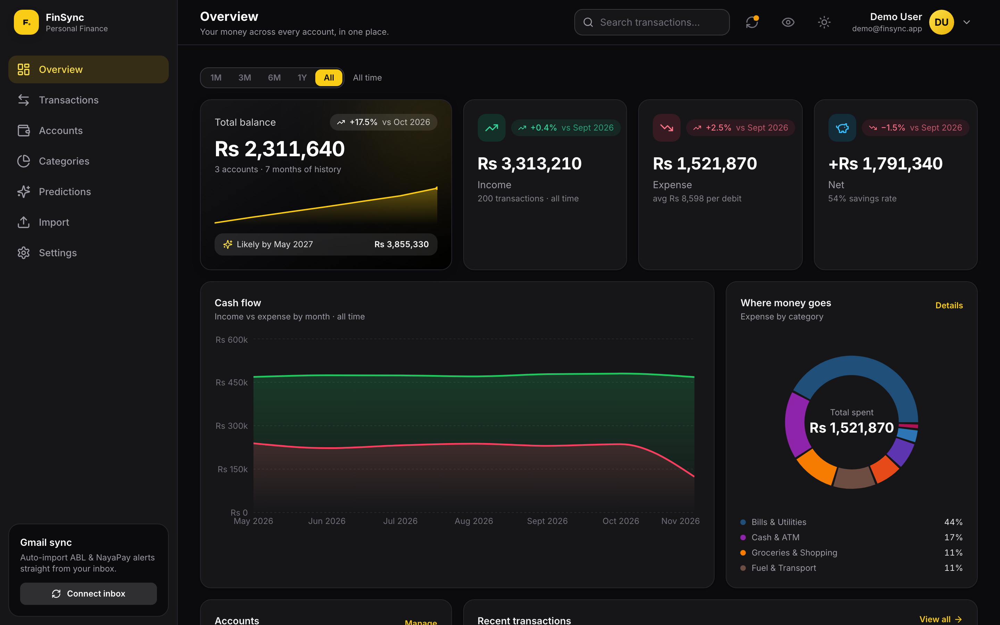
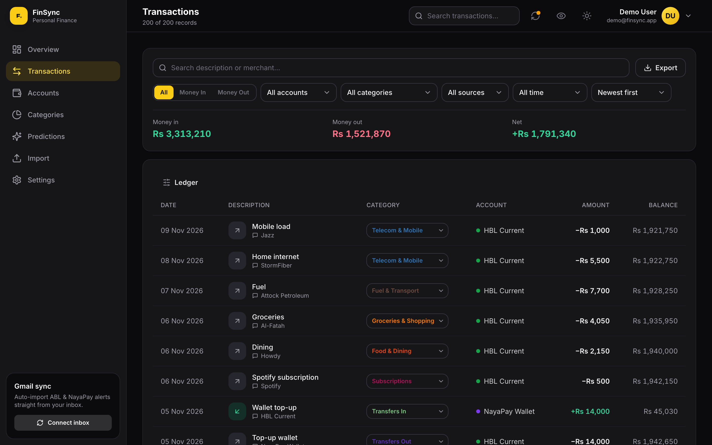
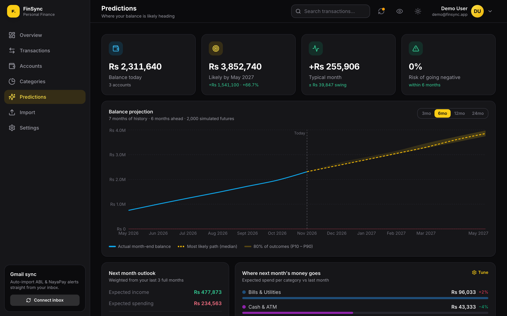
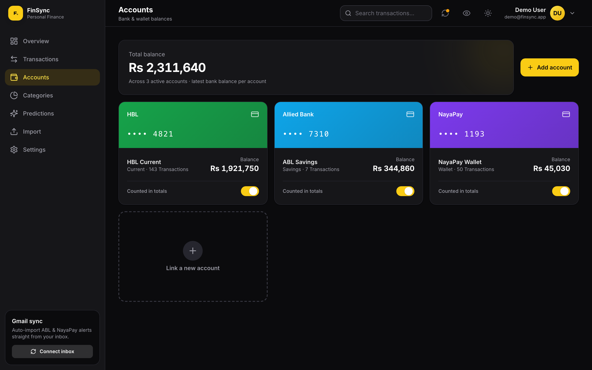
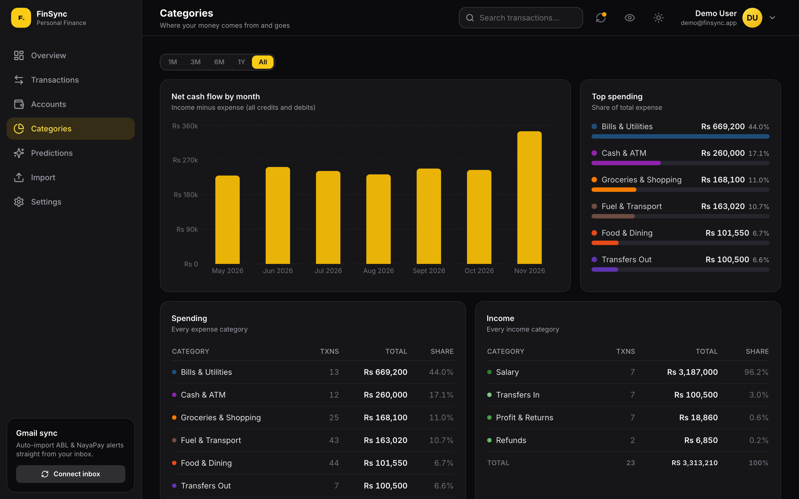

<div align="center">

# FinSync

### One honest ledger from three noisy banks.

Unify your own transactions from **Allied Bank**, **HBL**, and **NayaPay** —
scattered across email alerts, card SMS, and PDF statements — into a single,
deduplicated, categorized ledger with a dashboard, analytics, and forecasting.

<p>
  
  
  
  
  
  
  
</p>

<p>
  <a href="#live-demo"><b>Live demo</b></a> ·
  <a href="#architecture"><b>Architecture</b></a> ·
  <a href="#quick-start-local"><b>Quick start</b></a> ·
  <a href="#how-it-works"><b>How it works</b></a>
</p>

</div>

<p align="center">
  
</p>

> **Authorized, read-only access to your own data.** FinSync uses the official
> Gmail API (read-only OAuth) on your own inbox and the open-source
> [Android SMS Gateway](https://github.com/capcom6/android-sms-gateway) to
> forward your own incoming SMS. It never scrapes banking apps, never
> reverse-engineers private APIs, and never asks for passwords, OTPs, PINs,
> CVVs, or card numbers.

This is a solo project built to solve a real problem: no single bank app shows
the whole picture when money moves across three institutions and arrives through
three different channels. FinSync is the engine that reconciles them.

---

## Live demo

The landing page ships with a fully seeded **demo account** — click
**“View live demo”** to explore a populated dashboard, ledger, and forecast
without signing up.

| | |
|---|---|
| **Email** | `demo@finsync.app` |
| **Password** | `finsyncdemo` |

> The demo is a shared, read-only-style sandbox pre-loaded with ~6 months of
> synthetic transactions. All figures are illustrative.

---

## Screenshots

<table>
  <tr>
    <td width="50%" valign="top">
      <b>Transactions</b> — one searchable, deduplicated ledger<br>
      
    </td>
    <td width="50%" valign="top">
      <b>Predictions</b> — Monte-Carlo balance forecast<br>
      
    </td>
  </tr>
  <tr>
    <td width="50%" valign="top">
      <b>Accounts</b> — balances reconciled to the rupee<br>
      
    </td>
    <td width="50%" valign="top">
      <b>Categories</b> — spending grouped your way<br>
      
    </td>
  </tr>
</table>

---

## Highlights

- **Multi-channel ingestion** — Gmail API (ABL / HBL / NayaPay emails), HBL card
  & transfer SMS via a cloud SMS gateway, and PDF statement import.
- **One transaction, many sources** — email + SMS + statement evidence attach to
  the same financial record via `transaction_sources` instead of duplicating it.
- **Deterministic deduplication** — a SHA-256 `fingerprint` collapses the same
  event seen on different channels; ingestion is fully idempotent.
- **Cross-source reconciliation** — real-time email/SMS alerts are merged into
  the authoritative monthly statement row by reference and time.
- **Analytics & forecasting** — income/expense flows, category breakdowns,
  internal-transfer detection, and a cash-flow projection — all computed from the
  normalized ledger.
- **Full-stack & deployed** — FastAPI backend on Render, PostgreSQL on Neon,
  React dashboard on Vercel.

---

## Architecture

```
   ABL email ─┐
HBL transfer  │        ┌─ Gmail API (OAuth read-only) ─┐
     email ───┤        │                               │
              ├────────┤                               ├──► Ingestion pipeline
HBL card SMS ─┤        └─ Android SMS Gateway (cloud) ──┘            │
              │                                                      │
NayaPay email │        ┌─ PDF statement upload ────────────────────►│
              │                                                      ▼
   Statements ┘                          Normalize → Fingerprint → Deduplicate
                                                   → Reconcile → Categorize
                                                             │
                                                             ▼
                                                        PostgreSQL
                                             ┌───────────────┼───────────────┐
                                        Dashboard        Analytics        CSV export
```

| Provider | Transfers | Card / purchases | Statements |
|----------|-----------|------------------|------------|
| ABL      | Email (Gmail API) | Email (Gmail API) | PDF import |
| HBL      | Email (Gmail API) + SMS | SMS (gateway) | PDF import |
| NayaPay  | Email (Gmail API) | Email (Gmail API) | PDF import |

Everything funnels into one **`transactions`** table. Multiple sources attach to
the same row through `transaction_sources`, so the financial record is never
duplicated when the same event arrives on a second channel.

---

## Tech stack

**Backend** — Python 3.12, FastAPI, Pydantic v2, SQLAlchemy 2.x, Alembic,
PostgreSQL, bcrypt + JWT auth, Google API client (Gmail read-only), httpx,
`pdfplumber` for statement parsing, pytest.

**Frontend** — React 18, TypeScript, Vite, Tailwind CSS, Recharts,
React Router, lucide-react.

**Infra** — Docker / docker-compose for local Postgres + API, Render (backend),
Neon (managed Postgres), Vercel (frontend).

---

## Repository structure

```
FinSync/
├── backend/
│   ├── app/
│   │   ├── main.py              # FastAPI app + router wiring
│   │   ├── config.py            # env settings + providers.yaml loader
│   │   ├── database.py          # SQLAlchemy engine / session / Base
│   │   ├── core/security.py     # bcrypt hashing + JWT access tokens
│   │   ├── models/              # Transaction, TransactionSource, Account, User, …
│   │   ├── schemas/             # Pydantic: ParsedTransaction, API I/O, webhook
│   │   ├── api/routes/          # auth, transactions, accounts, analytics, export,
│   │   │                        #   sync, sms, webhooks, statements, preferences,
│   │   │                        #   maintenance, gmail_oauth, health
│   │   ├── services/
│   │   │   ├── gmail/           # read-only OAuth + Gmail client + sync
│   │   │   ├── sms/             # cloud gateway, HMAC signature, provider id
│   │   │   ├── ingestion/       # parse → fingerprint → dedup → persist
│   │   │   ├── reconciliation/  # cross-source duplicate detection
│   │   │   ├── statements/      # PDF statement importer
│   │   │   └── categorization/  # deterministic, config-driven rules
│   │   ├── parsers/             # abl_email, hbl_email, hbl_sms, nayapay_email,
│   │   │                        #   statement_pdf (+ base)
│   │   └── utils/               # fingerprint, amount & date parsing
│   ├── alembic/versions/        # migrations 0001–0006
│   ├── tests/                   # 71 tests (parsers, dedup, reconciliation, auth…)
│   ├── scripts/                 # ops: dedupe, reclean, replicate, enrich, smoke
│   ├── providers.yaml           # sender/pattern config + category rules
│   ├── Dockerfile · .env.example
│   └── requirements.txt
├── frontend/                    # React + Vite dashboard (Landing, Dashboard,
│   └── src/                     #   Transactions, Accounts, Predictions, Settings…)
├── android/documentation/       # SMS Gateway setup guide
├── notebooks/                   # Gmail exploration notebook (outputs cleared)
├── docker-compose.yml · render.yaml · vercel.json
└── README.md
```

---

## Quick start (local)

### 1. Backend + database

```bash
# From the repo root — start Postgres + the API (runs migrations automatically)
cp backend/.env.example backend/.env
docker compose up -d --build

curl http://localhost:8000/health        # → {"status":"ok"}
curl http://localhost:8000/health/db     # → {"status":"ok","database":"reachable"}
```

Interactive API docs: http://localhost:8000/docs

Prefer running the API outside Docker?

```bash
docker compose up -d db            # just the database
cd backend
python3.12 -m venv .venv && source .venv/bin/activate
pip install -r requirements.txt
cp .env.example .env               # DATABASE_URL → localhost:5432
alembic upgrade head
uvicorn app.main:app --reload --port 8000
```

### 2. Frontend

```bash
cd frontend
npm install
echo "VITE_API_URL=http://localhost:8000/api/v1" > .env   # see .env.example
npm run dev                        # http://localhost:5173
```

### 3. Tests

```bash
cd backend && source .venv/bin/activate
pytest -q                          # 71 passing; parser/dedup tests need no DB
```

---

## Environment variables

See `backend/.env.example` and `frontend/.env.example` for the full annotated
lists. Key backend settings:

| Variable | Purpose |
|----------|---------|
| `DATABASE_URL` | PostgreSQL connection (compose overrides host to `db`) |
| `JWT_SECRET_KEY` | Signing key for auth access tokens |
| `CORS_ORIGINS` | Allowed frontend origins |
| `GMAIL_CLIENT_ID` / `GMAIL_CLIENT_SECRET` | Web OAuth client (Google Cloud) |
| `GMAIL_OAUTH_REDIRECT_URI` | `https://<backend>/api/v1/sync/gmail/callback` |
| `FRONTEND_URL` | Where users return after authorizing Gmail |
| `SMS_CLOUD_USERNAME` / `SMS_CLOUD_PASSWORD` | Android SMS Gateway cloud creds |
| `SMS_WEBHOOK_PUBLIC_URL` | Public URL the phone delivers SMS batches to |
| `SMS_WEBHOOK_SIGNING_KEY` | HMAC key for webhook authentication |
| `PROVIDERS_CONFIG_FILE` | Path to `providers.yaml` |

Secrets live under `backend/secrets/` and `backend/.env` — both gitignored.

---

## How it works

### Deduplication

A robust `fingerprint` — `provider + type + amount + currency + account_last4 +
reference + rounded time bucket` — makes the same transaction collide across
channels. Ingestion resolves to one of:

- `unique` → new transaction created
- `exact_duplicate` → same fingerprint; attach the new source only
- `probable_duplicate` → same money + time window; attach source, raise
  confidence, and enrich blank fields (e.g. a generic statement row gains the
  sender name from its matching email)
- `needs_review` → similar but conflicting reference → **keep both**, flag

Re-processing the same Gmail message or SMS is a no-op, guarded by unique
`source_id` and `raw_hash`.

### Cross-source reconciliation

The same real event is often captured twice: a rich real-time **email/SMS alert**
(merchant, reference, exact time, no running balance) and the authoritative
**statement line** (running balance, generic description, posting date). Because
their dates and references differ, the fingerprint keeps both. A reconciliation
pass matches them by reference (strong) or nearest time within a few days
(fallback, same transaction kind), then keeps the statement row, enriches it from
the alert, repoints the alert's source onto it, and drops the duplicate.

### Analytics

Balances and flows are computed from the normalized ledger: per-account balances
anchor on the newest statement row with a running balance, income/expense flows
exclude detected internal transfers, and a simple projection forecasts cash flow.

---

## Deployment

- **Backend** → Render (Docker). `render.yaml` is a ready blueprint; set
  `DATABASE_URL` (Neon), `JWT_SECRET_KEY`, `CORS_ORIGINS`, and the Gmail/SMS
  values in the dashboard.
- **Database** → Neon (managed PostgreSQL); run `alembic upgrade head`.
- **Frontend** → Vercel; set `VITE_API_URL` to the Render backend URL.

---

## Security model

- **No secrets stored** — never passwords, OTPs, PINs, CVVs, or full card numbers.
- **Minimal SMS retention** — raw SMS text isn't persisted; only normalized
  fields plus a one-way hash for dedup. Unrelated SMS are rejected by the parser.
- **Gmail** — read-only OAuth, minimum scope (`gmail.readonly`); the refresh
  token is stored per-user in the database, never committed.
- **Webhook auth** — per-user signed token and/or HMAC-SHA256 with timestamp
  anti-replay.
- **Auth** — bcrypt password hashing, JWT access tokens.
- **Database** — parameterized SQLAlchemy queries, unique fingerprint constraint,
  Alembic-managed migrations.

---

## Author

Built by **Danish Zulfiqar** — [github.com/danishzulfiqar](https://github.com/danishzulfiqar).

A personal project for managing my own accounts. All figures in the code,
tests, and UI are illustrative/synthetic.
